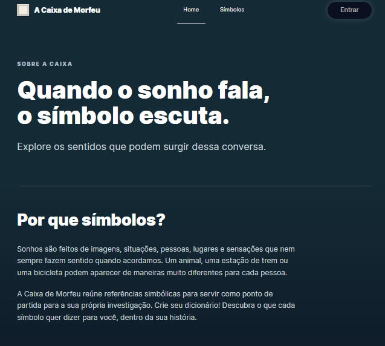
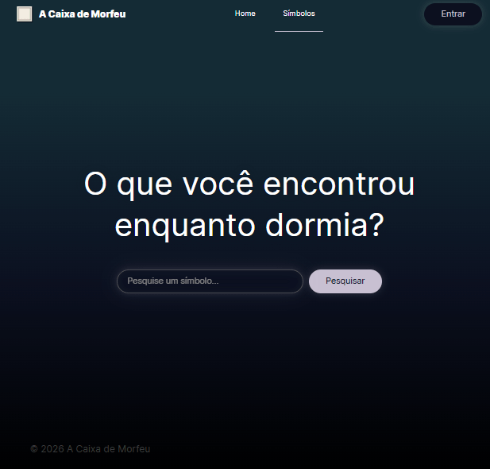
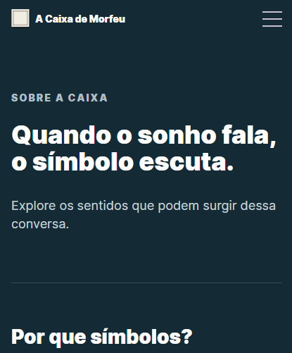

# A Caixa de Morfeu | Front-end

Uma ferramenta para explorar o simbolismo dos sonhos.

**A Caixa de Morfeu** permite pesquisar símbolos encontrados durante os sonhos, consultar seus significados a partir de diferentes perspectivas simbólicas e criar uma conta para registrar seus sonhos em um diário pessoal.

O projeto foi desenvolvido como trabalho final de um curso de desenvolvimento web full-stack.

## Funcionalidades

- Pesquisa de símbolos relacionados aos sonhos
- Consulta de interpretações simbólicas
- Tradução dos resultados para português
- Cadastro e login de usuários
- Autenticação para acesso às funcionalidades pessoais
- Registro de sonhos com data, descrição e indicação de recorrência
- Área Meus Sonhos para consultar e excluir registros
- Interface responsiva para diferentes tamanhos de tela

## Tecnologias

### Front-end

- React
- Vite
- React Router
- JavaScript
- HTML5
- CSS3

### APIs externas

- **Asterwise API** para consulta de símbolos e seus significados;
- **MyMemory API** para tradução dos termos e conteúdos retornados pela API para português.

As requisições à Asterwise são realizadas através de um proxy configurado no Vite.

### Integração com o back-end

O front-end se comunica com a API própria do projeto para cadastro, autenticação e gerenciamento dos sonhos registrados.

Repositório do back-end: caixa-de-morfeu-backend

## Como executar o projeto

### Pré-requisitos

- Node.js
- npm
- Git

### Instalação

Clone o repositório e acesse a pasta do projeto:

git clone https://github.com/ElisaRoque/caixa-de-morfeu-frontend
cd caixa-de-morfeu-frontend
npm install

Inicie o servidor de desenvolvimento:
npm run dev

O Vite exibirá no terminal o endereço local para acessar a aplicação.

## Próximas etapas

O projeto pode evoluir com novas funcionalidades de exploração simbólica, acompanhamento dos sonhos e aprimoramentos da experiência do usuário.

## Telas

🔗 **Acesse a aplicação:** [A Caixa de Morfeu](https://dream.zef.ro)
